<!-- PROFILE-CARDS:START -->
<table align="center" border="0">
  <tr>
    <td width="50%" valign="top"></td>
    <td width="50%" valign="top"></td>
  </tr>
</table>

  

<!-- PROFILE-CARDS:END -->

### Hi, I'm Uma 👋

**Senior Mobile & IoT Software Engineer** with 15+ years of building production Android, iOS and cross-platform apps, plus the firmware and connected systems behind them. I lead code reviews, mentor developers, and work closely with hardware, firmware and cloud teams to ship apps on Google Play and the App Store.

- 🛰️ **Now:** building FASTER at DBTech, a BLE Mesh festival-safety wearable (STM32WB55 firmware, SOS system, OTA design, Android app, Supabase backend)
- 🤖 **AI:** private, on-premise RAG assistants with Pinecone, GPT-4o and LLaMA 3 (vLLM)
- 🏠 **IoT:** smart-home control over BLE, Wi-Fi sockets and AWS, with OTA gateway updates
- 🔐 **Security:** offline NFC password manager with AES / RSA / SHA-256 crypto
- 🌱 **Always:** mentoring, clean architecture (MVVM / Clean), and CI/CD

### 🚀 Featured work

| Project | What it is | Link |
|---|---|---|
| **FASTER** (DBTech) | BLE Mesh safety wristband: SOS in under 100 ms, USB gateway, Android app | private (client work) |
| **Private AI Assistant** (ThruLiquid) | ChatGPT-style RAG assistant for confidential case files, deployed on-prem | [showcase repo](https://github.com/umasenthil2214/uma-thruliquid-PrivateAI) |
| **Levven Controls** | Smart-home app for lights, dimmers and fans (Flutter + Kotlin) | [App Store](https://apps.apple.com/ca/app/levven-controls/id1436898660) |
| **Stash** (Elsi Inc) | Offline hardware password manager, tap-to-phone over NFC | [Google Play](https://play.google.com/store/apps/details?id=com.elsiinc.stashpass) |
| **MyMilan** (Milanity) | Home automation: lights, AC, cameras, IR universal remote | [Google Play](https://play.google.com/store/apps/details?id=com.milanity.mymilan) |

### 💼 Experience

| When | Role | Company |
|---|---|---|
| 2026 – now | Senior Embedded Firmware & Mobile Engineer (IoT Wearables) | DBTech (remote, Texas) |
| 2024 – 2026 | Senior Mobile Developer & AI Consultant (LLM / RAG) | ThruLiquid Inc, Mississauga |
| 2021 – 2024 | Senior Mobile Application Developer (Smart Home IoT) | Levven Electronics, Edmonton |
| 2019 – 2021 | Senior Android Developer (Mobile Security & NFC) | Elsi Inc (Stash), Edmonton |
| 2018 | Senior Mobile Developer | ThruLiquid Inc, Toronto |
| 2017 – 2018 | Android & Web Developer | WebsZilla Technology, Chennai |
| 2013 – 2016 | Senior Android Developer / Mobile Team Lead | Eloka Enterprises (Milanity), Chennai |
| 2011 – 2013 | Android Developer (Mobile Games) | NETAXIS IT Solution, Chennai |

🎓 **M.Sc. Information Technology** (U.S. equivalency certified) · **Bachelor of Computer Applications**

### 🧰 Tech stack

**📱 Mobile** 
       

**📡 IoT & Embedded** 
    

**🤖 AI & LLM** 
   

**☁️ Cloud & Backend** 
       

**🛠️ Web, Games & DevOps** 
     

📫 Connect with me on [LinkedIn](https://www.linkedin.com/in/umamaheswari-senthil-2ab26949)
